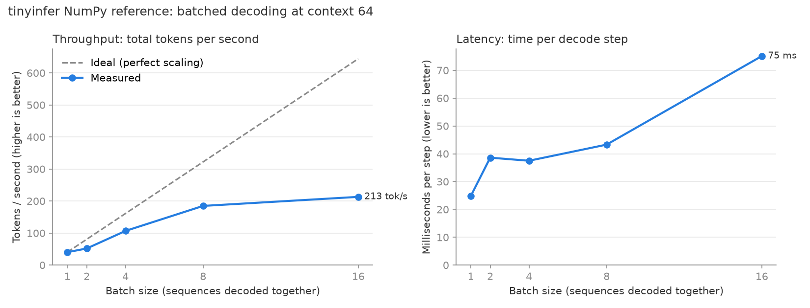
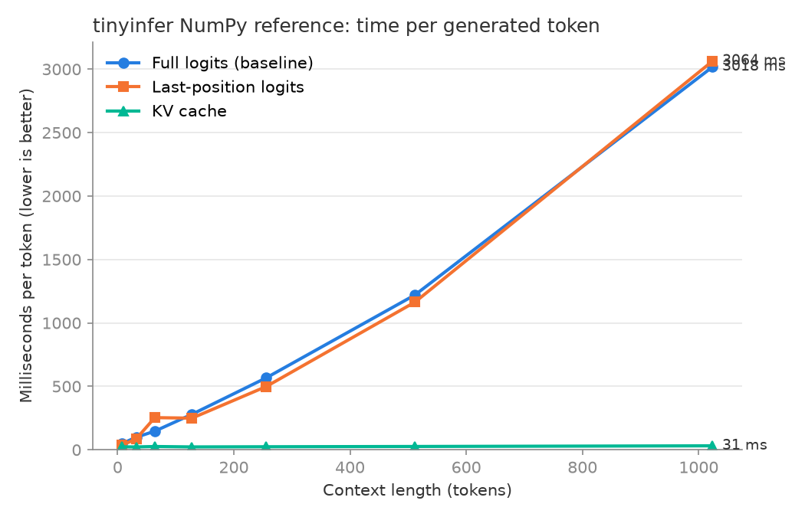

# tinyinfer
A from-scratch, dependency-free LLM inference engine in C++ that runs fast
on laptops and Raspberry Pi, with an OpenAI-compatible API.

🚧 Work in progress, built step by step while learning.

## Status

✅ **Milestone 1: NumPy reference engine.** GPT-2 (124M) forward pass in pure NumPy,
matching Hugging Face outputs (max logit diff < 1e-3, identical greedy generations).

## Quick start

```bash
pip install -r requirements.txt
python scripts/export_weights.py      # one-time: export GPT-2 weights to NumPy
python generate.py "Sri Lanka is famous for" -n 30
pytest -v                             # run all tests
```
## INT8 quantization

Weight-only, symmetric, per-channel INT8: `w ≈ q × scale`, with one float32 scale per
output column, so an outlier weight only affects its own column. INT8 matmuls use
`(x @ q) × scale`, scaling the outputs instead of every weight.

```bash
python generate.py "Sri Lanka is famous for" --int8
python eval_quant.py            # quality, memory and speed vs float32
python eval_quant.py --ablate   # which parts can be quantized safely?
```

### Results (2,044 tokens of Tiny Shakespeare)

| | float32 | INT8 (mixed precision) |
|---|---|---|
| Weights in memory | 498 MB | **243 MB (2.05x smaller)** |
| Perplexity | 88.90 | 87.96 (−1.06%) |
| Top-1 agreement | | 97.46% |
| KL divergence (mean) | | 0.00135 |
| Greedy output | | identical to float32 on the test prompt |

### Ablation: why the embeddings stay float32

Quantizing everything first gave a 3.9x smaller model but **+4.98% perplexity and only
79% top-1 agreement**. Quantizing each part separately found the cause:

| Quantized | Size | Perplexity | Top-1 | KL |
|---|---|---|---|---|
| Blocks only | 243 MB | −1.06% | 97.46% | 0.00135 |
| Embeddings only | 382 MB | +6.14% | 79.25% | 0.05809 |
| Everything | 128 MB | +4.98% | 79.05% | 0.05955 |

The token embedding table doubles as the output layer (weight tying), so its rounding
errors directly reorder the next-token ranking. The default `--int8` therefore quantizes
the block matmuls and keeps embeddings in float32. Next step: group-wise INT8
(one scale per 32–64 values, like llama.cpp's Q8_0) for the embeddings.

**Lesson learned: raw logit difference is a misleading metric.** "Blocks only" has a
*larger* max logit difference (52 vs 8) but 43x lower KL divergence. Softmax ignores
shifting all logits by the same amount, so a big uniform shift is harmless.
KL divergence measures what actually matters.

### Speed: honest note
In NumPy, INT8 is slower (95.8 ms vs 23.4 ms per decode step at context 128): NumPy can't
multiply int8 by float32 directly, so every matmul first makes a temporary float32 copy of
the weights. The float32 decode step reads ~498 MB in ~23 ms (≈21 GB/s), close to typical
laptop memory bandwidth, so decoding is likely memory-bound. Smaller weights should pay off
in a native kernel that reads int8 directly (planned for the C++ engine).

## Batching

Several sequences are decoded together. Each prompt is prefilled separately into its own
slot of a batch KV cache (prompts have different lengths), then every decode step processes
one new token for **all** sequences at once: one matmul per layer serves every sequence, so
the weights are read once per step instead of once per sequence. Each slot keeps its own
position and attention mask. Batched outputs are tested to be identical to one-by-one
generation and to Hugging Face GPT-2.

```bash
python batch_demo.py                                  # 4 prompts, batched vs one at a time
python bench_batch.py && python scripts/plot_batch.py
```



| Batch size | Step latency (ms) | Throughput (tokens/s) | Throughput vs 1 | Latency vs 1 |
|---|---|---|---|---|
| 1 | 24.8 | 40.3 | 1.00x | 1.00x |
| 2 | 38.6 | 51.8 | 1.29x | 1.56x |
| 4 | 37.5 | 106.7 | 2.65x | 1.51x |
| 8 | 43.3 | 184.8 | **4.59x** | 1.75x |
| 16 | 75.1 | 213.0 | 5.29x | 3.03x |

*Context 64, median of 5 runs after 2 warm-ups.* Batch 8 is the sweet spot on this laptop:
4.6x the throughput for 1.75x the per-token latency.

### Why batch 2 barely helps: a matmul micro-benchmark

| Matmul (ms) | B=1 | B=2 | B=4 | B=8 | B=16 |
|---|---|---|---|---|---|
| attn.c_attn (768×2304) | 0.25 | 0.56 | 0.53 | 0.54 | 0.63 |
| mlp.c_fc (768×3072) | 0.23 | 0.66 | 0.66 | 0.67 | 0.87 |
| mlp.c_proj (3072×768) | 0.30 | 0.76 | 0.78 | 0.78 | 0.84 |
| lm_head (768×50257) | 5.85 | 7.16 | 6.99 | 7.55 | 9.10 |

- **B=1 → B=2 jumps 2.3–2.9x:** with one row, BLAS uses a fast matrix-vector path (gemv);
  with two or more rows it switches to matrix-matrix (gemm), which first packs (copies)
  the weights. For skinny matrices that overhead dominates.
- **B=2 → B=8 is almost flat:** once in gemm, more rows are nearly free, because the
  weights are read once regardless. This is batching working as intended.
- **lm_head: 16x the tokens for 1.6x the time.** At B=1 it streams 154 MB in 5.85 ms
  (≈26 GB/s), near this laptop's memory bandwidth. Decoding is memory-bound, which is
  why batching (and smaller weights) pay off.
- Smaller matrices stay hot in the CPU cache during the micro-benchmark, so their times
  look faster than real DRAM reads. Only lm_head (154 MB) reflects true memory bandwidth.

**Takeaway for the C++ engine:** a decode kernel built for skinny matrices (2–16 rows)
should close the gap to ideal scaling that generic BLAS leaves.

## Benchmarks

Time per generated token (one decode step), median of 5 runs after 2 warm-up runs.
Run `python bench.py` then `python scripts/plot_bench.py` to reproduce.



| Context | Full logits (ms) | Last-position logits (ms) | KV cache (ms) | KV cache speedup |
|---|---|---|---|---|
| 8 | 49.6 | 36.4 | 23.3 | 2.1x |
| 32 | 98.8 | 86.0 | 22.5 | 4.4x |
| 64 | 146.6 | 253.4* | 25.9 | 5.7x |
| 128 | 279.7 | 249.4 | 22.6 | 12.4x |
| 256 | 567.4 | 499.0 | 23.9 | 23.7x |
| 512 | 1221.0 | 1164.7 | 26.1 | 46.8x |
| 1024 | 3018.1 | 3063.8* | 31.3 | **96.4x** |

**The KV cache makes decoding nearly independent of context length:** 128x more
context (8 → 1024) costs only ~34% more time per token (23.3 → 31.3 ms), so the engine
stays above ~30 tokens/s all the way to GPT-2's full 1024-token window. Without the
cache, every new token recomputes the whole sequence, so time grows with context
and a token at 1024 takes over 3 seconds.

**Last-position logits** help at short contexts (1.36x at 8) but the gain fades at long
ones: lm_head is ~30% of the FLOPs but much less of the wall time, since it's one large,
efficient BLAS matmul while the blocks run many smaller matmuls and memory-bound
elementwise ops. FLOPs ≠ time.

\* *Measurement noise: last-position logits never does more work than full logits.
Its small gain at long contexts is within this laptop's run-to-run variance
(thermal throttling and background load). The KV cache's 96x gain is far above the noise.*

### History
- Fixed a silent float64 upcast under NumPy 2 (1.3 → 2.0 tokens/s end-to-end)
- Compute lm_head logits only for the last position during generation (up to 1.36x)
- KV cache with prefill/decode: up to 96x faster per token at 1024 context;
  100-token generation went 5.5 → 21.1 tokens/s end-to-end
- Mixed-precision INT8 (blocks INT8, embeddings float32): 498 → 243 MB, perplexity −1.06%, top-1 97.46%
- Batched decoding with per-sequence positions and masks: up to 5.3x throughput (213 tokens/s at batch 16)